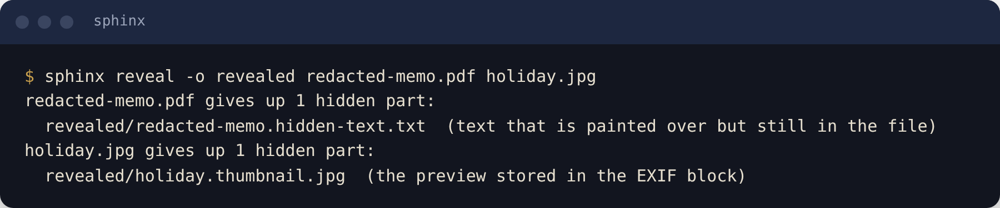
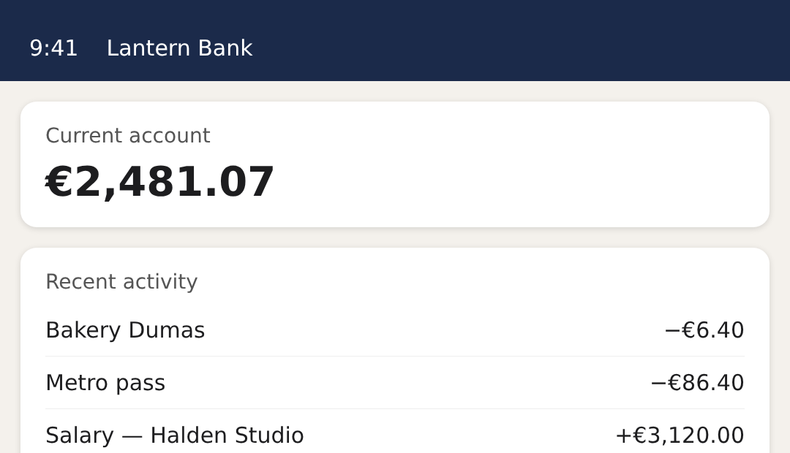

<p align="center">
  
</p>

<h1 align="center">Sphinx</h1>

<p align="center"><strong>Know what your files give away before you share them.</strong></p>

<p align="center">
  <a href="https://github.com/xCeg/Sphinx/actions/workflows/ci.yml"></a>
  <a href="https://github.com/xCeg/Sphinx/releases"></a>
  <a href="https://pkg.go.dev/github.com/xceg/sphinx"></a>
  <a href="LICENSE"></a>
  <a href="https://xceg.github.io/Sphinx/"></a>
</p>

<p align="center">
  <a href="#why">Why</a> ·
  <a href="#quick-start">Quick start</a> ·
  <a href="#what-it-asks">What it asks</a> ·
  <a href="#how-it-works">How it works</a> ·
  <a href="#calibration">Calibration</a> ·
  <a href="#usage">Usage</a> ·
  <a href="#integrations">Integrations</a> ·
  <a href="#limitations">Limitations</a>
</p>

<p align="center"></p>

Sphinx reads a photo, screenshot, PDF, Office document, SVG drawing or zip archive and tells you, in plain words, what it reveals beyond what you see. That can be pixels that survived a crop, text under black boxes, instructions hidden for AI tools, earlier versions, deleted passages, hidden sheets and layers, GPS positions, serial numbers, printer and server names, or the files a folder held. It then shows you those hidden parts (`sphinx reveal`) and writes a cleaned copy (`sphinx seal`).

It is a single binary with no dependencies. The same engine runs on [a web page](https://xceg.github.io/Sphinx/) inside your browser, so the file never leaves your machine.

## Why

What a viewer shows you is not the file. It is one rendering of it, and files keep a lot that no viewer draws.

- **July 2025.** Nikkei Asia found seventeen research preprints on arXiv with instructions hidden in white text or tiny fonts, some beginning "ignore previous instructions", aimed at AI tools used to review papers ([Schneier on Security](https://www.schneier.com/blog/archives/2025/07/hiding-prompt-injections-in-academic-papers.html)).
- **March 2023.** Simon Aarons and David Buchanan found that the Markup editor on Google Pixel phones saved a cropped screenshot by writing it over the original without shortening the file. The bottom of the original stayed behind and could be decoded again. The Windows Snipping Tool had the same flaw. Both are tracked as CVE-2023-21036 and CVE-2023-28303 ([aCropalypse](https://en.wikipedia.org/wiki/ACropalypse)).
- **January 2019.** Paul Manafort's lawyers filed a document whose blacked-out passages could be selected, copied and pasted, revealing what the redactions were meant to hide ([Columbia Journalism Review](https://www.cjr.org/analysis/manafort-mueller-redacted-document-ukraine.php)).
- **December 2012.** A photo of John McAfee, then wanted for questioning in Belize, was published with its EXIF GPS coordinates intact. They placed him in Guatemala ([NPR](https://www.npr.org/sections/thetwo-way/2012/12/04/166487197/betrayed-by-metadata-john-mcafee-admits-hes-really-in-guatemala)).
- **October 2005.** A UN report on the assassination of Rafik Hariri was released as a Word file. Its tracked changes showed names that had been deleted from the final text ([Mehlis report](https://en.wikipedia.org/wiki/Mehlis_report)).

Each of these files looked fine on screen. Existing tools each cover a slice: `exiftool` lists metadata, `mat2` strips it, a few scripts detect aCropalypse, and the Free Law Project's `x-ray` finds bad PDF redactions. None of them answers the question people actually have before pressing send: *what does this file give away?* None covers the formats people actually send, in words a non-specialist understands.

## Quick start

```sh
go install github.com/xceg/sphinx/cmd/sphinx@latest   # or grab a binary from Releases
sphinx ~/Desktop/to-send/
```

Or open <https://xceg.github.io/Sphinx/> and drop files or a folder on the page. The example files used throughout this README are in [`site/examples`](site/examples). Every leak in them is planted and every name is invented.

```sh
sphinx reveal cropped-screenshot.png    # writes cropped-screenshot.revealed/…uncropped.png
sphinx seal holiday.jpg                 # writes holiday.sealed.jpg, then checks it again
```

<p align="center"></p>

| What anyone opening `cropped-screenshot.png` sees | What `sphinx reveal` gets back from the same file |
|---|---|
|  |  |

## What it asks

Sphinx asks every file 23 questions:

| Rule | What the file gives away | Formats | `reveal` | `seal` |
|---|---|---|:-:|:-:|
| `SPX001` hidden-crop | Cropped-out pixels still stored after the image (aCropalypse) | PNG | yes | yes |
| `SPX002` blacked-out-text | Text under boxes painted over it | PDF | yes | |
| `SPX003` unapplied-redaction | Redaction marks that were never applied | PDF | yes | |
| `SPX004` earlier-revision | Earlier versions kept by incremental saves, with the words they lost | PDF | yes | yes |
| `SPX005` deleted-text | Passages deleted under Track Changes | DOCX | yes | |
| `SPX006` gps-location | Where the photo was taken | JPEG, PNG, WebP, pictures in SVG and Office files | | yes |
| `SPX007` thumbnail-mismatch | A preview that still shows what was cropped or retouched away | JPEG | yes | yes |
| `SPX008` hidden-video | The video and sound of a motion photo | JPEG | yes | yes |
| `SPX009` trailing-data | Data stored after the end of an image | JPEG, PNG, WebP | yes | yes |
| `SPX010` hidden-content | Hidden text, sheets, columns, rows, slides, speaker notes, pivot caches, document variables | DOCX, XLSX, PPTX | yes | |
| `SPX011` comments | Review comments and who wrote them | PDF, Office | yes | |
| `SPX012` personal-names | Authors, last editors, company | all | | yes |
| `SPX013` device-serial | Camera and lens serial numbers | JPEG, PNG, WebP | | yes |
| `SPX014` local-paths | Paths such as `C:\Users\alice\…`, network printers and shares | PDF, Office, SVG, zip | | mostly |
| `SPX015` embedded-files | Attachments, embedded objects, VBA macro projects | PDF, Office | yes | |
| `SPX016` embedded-text | Captions, comments, AI generation prompts | JPEG, PNG, WebP, SVG | | yes |
| `SPX017` timestamps | Creation, edit and print dates | all | | yes |
| `SPX018` software-trail | Device, software, printers, edit count and editing time | all | | yes |
| `SPX019` hidden-instructions | Hidden text addressed to AI tools ("ignore previous instructions…") | PDF, DOCX, PPTX, SVG | yes | |
| `SPX020` invisible-text | Text drawn so that nobody sees it: white on white, microscopic, off the page or slide, clipped, invisible ink, switched-off layers | PDF, DOCX, PPTX, SVG | yes | |
| `SPX021` form-data | Values typed into form fields, including hidden ones | PDF | yes | |
| `SPX022` content-credentials | A signed C2PA history of how the image was made | JPEG, PNG, WebP | | yes |
| `SPX023` archive-junk | `.DS_Store`, `__MACOSX`, `Thumbs.db`, and the files a `.DS_Store` names that the archive left out | zip | yes | yes |

The full text of each rule, as `sphinx rules RULE` prints it, is in [docs/rules.md](docs/rules.md). That file is generated from the code, and a test fails when it falls behind.

Each file gets a verdict: **silent** (nothing found), **whispers** (only low-severity details such as timestamps), or **betrays** (anything medium or worse).

## How it works

```
          bytes ──► sniff by content ──► PNG │ JPEG │ WebP │ SVG │ PDF │ DOCX/XLSX/PPTX │ ZIP
                                          │                                            │
              ┌───────────────────────────┼─────────────────────────┐      each member, back
              ▼                           ▼                         ▼      through the engine
     data after the end          what is painted where       parts no viewer shows
  (IEND/EOI, orphan DEFLATE)  (paint order, colour, clip,   (tracked changes, notes,
                               layers, revisions)            hidden layers, .DS_Store)
              └──────────► findings (rule, severity, plain-language message, evidence)
                                          │
                     text · JSON · SARIF · Markdown │ reveal │ seal
```

Everything is written from scratch on Go's standard library. Four parts carry most of the weight.

**Recovering a crop without being told the original size.** In an aCropalypse file, the cropped PNG ends and the tail of the original's compressed stream follows it. That tail starts midway through a DEFLATE block, and the 32 KiB of history it refers to is gone. `internal/inflate` is a DEFLATE decoder that tolerates this: references into the missing history produce bytes flagged as unknown instead of an error. To find where a block starts, it tries every bit offset. Only offsets that begin a dynamic-Huffman block with two complete prefix codes are decoded in full, and the decode must end exactly on the byte before the Adler-32 checksum. Most random offsets fail within a few dozen bits.

The original width is inferred rather than asked for. PNG rows resemble the row above, so the most frequent back-reference distances in the stream point to the row stride. A candidate stride is confirmed when counting back from the end lands on filter-type bytes, and candidates are ranked by how smooth the image is once unfiltered. On the 1080×2000 example screenshot, `sphinx reveal` takes about half a second, including PNG encoding of the result.

**Seeing what a PDF paints, and in what order.** A redaction is a matter of order: a box drawn after the text hides it, while a box drawn before is a background. The PDF reader in `internal/pdf` locates objects by scanning instead of trusting the cross-reference table, which is often stale in exactly the files worth checking. It decrypts files that open with an empty user or owner password (standard security handler, revisions 2 to 6) and unpacks object streams. It interprets content streams far enough to place every glyph, with its font, colour, rendering mode, clipping and optional-content layer, and every filled shape. A glyph counts as covered when an opaque rectangle painted later covers its centre and most of its area. It counts as invisible when it is white on an unpainted page, smaller than one point, outside the page, clipped away, in invisible ink without a scan under it, or in a layer switched off by default. Every incremental update is replayed as its own document, and Sphinx reports the words found in an older revision but missing from the final one.

**Telling a hidden instruction from a mention.** `internal/aitext` matches phrasings that address a model ("ignore all previous instructions", "rank this candidate first", "do not highlight any negatives") rather than words such as "AI" or "language model". It only runs on text that readers cannot see. A paper that *discusses* prompt injection in visible text is not reported.

**Comparing a photo with its own preview.** Both images are reduced to a 32×32 luminance grid after trimming letterbox bars and normalising brightness and contrast. Previews that show *less* than the photo, such as the centre crop some cameras make, are accepted. Previews that show more, or something else, are reported.

## Calibration

Sphinx was run on 4,257 public test files, many of them deliberately malformed (fuzzer crash cases, truncated and encrypted files). The sources are:

- the [pdf.js](https://github.com/mozilla/pdf.js/tree/master/test/pdfs) and [py-pdf](https://github.com/py-pdf/sample-files) PDF suites;
- the [exif-samples](https://github.com/ianare/exif-samples) camera collection;
- [Apache POI](https://github.com/apache/poi/tree/trunk/test-data)'s Office test data;
- [Bootstrap Icons](https://github.com/twbs/icons) and [KDE Breeze](https://github.com/KDE/breeze-icons) icons.

`scripts/fetch-corpus.sh` pins every corpus to the exact commit used, and `go run ./scripts/calibrate DIR...` prints these tables.

| Format | Files | Size | Unreadable | Medium or worse | Time |
|---|---:|---:|---:|---:|---:|
| DOCX | 136 | 8 MB | 13 | 102 | 1.49 s |
| JPEG | 104 | 46 MB | 1 | 25 | 2.16 s |
| PDF | 1,140 | 163 MB | 11 | 232 | 8.71 s |
| PNG | 24 | 3 MB | 0 | 0 | 0.00 s |
| PPTX | 93 | 22 MB | 11 | 79 | 1.47 s |
| SVG | 2,371 | 5 MB | 0 | 8 | 0.13 s |
| XLSX | 381 | 22 MB | 13 | 306 | 6.28 s |
| ZIP | 8 | 0 MB | 1 | 0 | 0.01 s |

The run took 20.3 s on one core of an Intel Xeon at 2.10 GHz, with no crash and no hang. The unreadable PDFs need a real password (poppler cannot open them either, except two malformed fixtures). Before decryption was added, 27 PDFs were unreadable. The unreadable Office files are not valid zip archives, mostly minimised fuzzer cases.

"Medium or worse" is dominated by author names (`SPX012`), which Office and PDF producers write by default. The serious findings were each checked by hand:

| Finding | Files | Checked how | Result |
|---|---:|---|---|
| `SPX004` earlier revision with removed words | 11 PDFs, 16 findings | each revision extracted with `sphinx reveal`, then text extracted from it and from the final file with poppler's `pdftotext` | 15 confirmed word for word; in the 16th, the final file has no extractable text at all. |
| `SPX002` text under a box | 7 PDFs | pages rendered with poppler's `pdftoppm` | In all 7 the text is genuinely painted over. All are test fixtures about overlapping graphics or web pages printed under a sticky header. |
| `SPX020` invisible text | 21 PDFs, 1 DOCX | each reported passage read; the white-on-white ones rendered | Hidden layers, form text placed off the page, invisible-ink fixtures, white page numbers; one Word drawing whose shape fill Sphinx does not read. |
| `SPX007` stale preview | 1 JPEG | preview extracted and compared by eye | The photo was cropped to the car; the preview still shows the whole car park. |
| `SPX014` local paths in SVG | 8 Breeze icons | read | Inkscape export paths in the designers' home folders, still shipped in a widely distributed icon set. |
| `SPX014` printers | 29 POI workbooks | read | Network printer paths naming internal servers, two of them by IP address. |

Calibration also changed the code. A first version of the invisible-text check flagged 74 of the 1,140 PDFs. Each cause of noise was fixed and pinned by a test (`TestVisibleTextIsNotInvisible`, `TestCalibrationNearMisses`):

- white text on rounded or gradient boxes, on a dark shadow copy, or with an outline;
- OCR layers over scans;
- text used as a clipping mask;
- the microscopic credit TCPDF prints on every page;
- words cut at the page edge;
- fills clipped away by a form's bounding box;
- an annotation whose appearance differs from its declared colour.

Word's white text in shaded cells and text boxes took the Office count from six documents to one. A relative Inkscape export name had been taken for a path. Thumbnail thresholds come from the same corpus: the 32 unedited camera previews stay within 0.18 standard deviations of their photo, the cropped photo's stale preview scores 0.83, and the threshold is 0.45.

`sphinx seal` was checked the same way. Every PDF in the corpus was sealed, and the text of original and sealed copy compared with poppler. All 1,093 sealed files that poppler can read keep exactly their original text. The remaining 39 were refused on purpose: encrypted, too damaged to rewrite, or not PDFs. Checking this turned up two reader bugs, both now fixed: a page dictionary with a stray parenthesis lost its page, and a damaged catalog with no page tree gave no pages.

## Usage

```
sphinx [gaze] [flags] FILE|DIR...   inspect files and report what they leak
sphinx reveal [-o DIR] FILE...      extract what the files hide
sphinx seal [-o DIR | --in-place] FILE...
                                    write copies with the leaks removed, then re-inspect them
sphinx rules [RULE]                 explain each kind of leak
sphinx version
```

Directories are walked recursively. Only files whose *content* is a supported format are inspected, whatever their extension. `.git`, `node_modules` and hidden directories are skipped. `-` reads standard input.

| Flag (`gaze`) | Default | |
|---|---|---|
| `--format` | `text` | `text`, `json`, `sarif` or `markdown` |
| `--fail-on` | `medium` | exit 1 when a finding reaches this severity (`low`, `medium`, `high`, `critical`, `never`) |
| `--min-severity` | `low` | hide findings below this severity |
| `--exclude` | | skip paths matching a glob or directory name while walking; repeatable |
| `--quiet` | | list only files that leak or could not be read |
| `--no-color` | | colours are also off when `NO_COLOR` is set or output is not a terminal; `FORCE_COLOR` turns them on |

| Exit code | Meaning |
|---|---|
| 0 | nothing at or above `--fail-on` |
| 1 | at least one finding at or above `--fail-on` (for `seal`: one survived sealing) |
| 2 | usage error |
| 3 | a file could not be read or parsed, and nothing reached `--fail-on` |

**What `seal` does and does not do.** What it removes depends on the format:

- **Images:** it keeps only what decoding needs (pixels, colour profile and orientation) and drops metadata, previews, trailing data, motion-photo video and Content Credentials. Orientation is kept in a minimal EXIF block so portraits do not turn sideways.
- **PDFs:** it writes the final version alone, keeping only the objects reachable from the document, without the information dictionary or XMP metadata. Encrypted PDFs are refused, because rewriting one would remove its protection.
- **Office files:** it rewrites the properties, strips local paths from links, blanks printer names and seals the pictures inside.
- **SVGs:** it drops comments, metadata and editor data.
- **Zip archives:** it drops system files and seals every member.

It deliberately leaves tracked changes, comments, hidden text and layers, form data and text under boxes alone, because deciding what a document says is the author's job. These stay in the report printed after sealing. To remove text under a box, use a real redaction feature, then check the result with Sphinx.

## Integrations

**GitHub Action.** It fails a pull request that adds a leaking document, and sends the findings to code scanning:

```yaml
- uses: xCeg/Sphinx@v0.1.0
  with:
    paths: docs/ press/
    fail-on: medium
    sarif: sphinx.sarif
- uses: github/codeql-action/upload-sarif@51f77329afa6477de8c49fc9c7046c15b9a4e79d # v3.29.5
  if: always()
  with:
    sarif_file: sphinx.sarif
```

**pre-commit.**

```yaml
- repo: https://github.com/xCeg/Sphinx
  rev: v0.1.0
  hooks:
    - id: sphinx
```

**Docker.** No image is published yet; build one from the repository:

```sh
docker build -t sphinx .
docker run --rm -v "$PWD:/work" sphinx .
```

**Go library.**

```go
import "github.com/xceg/sphinx"

findings, err := sphinx.Inspect(data)   // most severe first
hidden, err := sphinx.Reveal(data)      // []Artifact{Name, Note, Data}
clean, err := sphinx.Seal(data)
```

**In the browser.** [`cmd/sphinx-wasm`](cmd/sphinx-wasm) compiles the library to WebAssembly for the [website](https://xceg.github.io/Sphinx/). The site takes several files or a whole folder at once and exports Markdown or JSON reports. A service worker keeps it working offline, so it can be installed as an app. `make serve` runs it locally. The page has a strict Content Security Policy, no analytics and no server-side code.

## Limitations

- **Formats.** Sphinx does not read HEIC/HEIF photos (the iPhone default), TIFF, ODF, legacy `.doc`/`.xls`/`.ppt`, email or video yet. PDFs and Office files that need a password are reported as unreadable.
- **Recovered crops are imperfect.** Bytes that referred to the lost part of the stream are decoded as zero, and the error propagates down through PNG's Up and Paeth filters as colour drift. Text usually stays legible, as in the example, but not always. Only crops written over the original are recoverable; a crop saved as a new file leaves nothing behind.
- **PDF geometry is approximate.** Glyph boxes come from font metrics, not glyph outlines. Non-rectangular shapes are not treated as covers. Text hidden behind images is not detected. White text counts as visible over any painted shape or picture, even a light one.
- **Word and PowerPoint formatting is read directly, not through styles.** White text set by a style rather than on the run, or inside a shape whose fill Sphinx does not read, can be missed or, rarely, reported. Shapes inside groups are not checked for being off the slide.
- **Hidden-instruction detection matches phrasings.** A hidden instruction worded unlike the known patterns, or in another language, is reported as invisible text but not as an instruction.
- **Revision diffs compare words, not meaning.** A word removed in one place but present elsewhere in the final version is not reported.
- **Absence of findings is not proof of safety.** Sphinx answers 23 specific questions, and a file can leak in ways none of them covers, starting with what is plainly visible in it.

## Roadmap

- HEIC photos, ODF documents and legacy Office binaries.
- Detecting text hidden behind images in PDFs.
- Reading Word styles and shape fills for invisible-text checks.
- A share-sheet extension for phones, built on the WebAssembly engine.

## Contributing

Bug reports with a reproducible file are the most valuable contribution. Please make the file with invented content, never real personal data. [CONTRIBUTING.md](CONTRIBUTING.md) describes the layout of the code and the rule that every new check comes with a test for the closest legitimate case. Report security issues as described in [SECURITY.md](SECURITY.md).

## License

[MIT](LICENSE).
