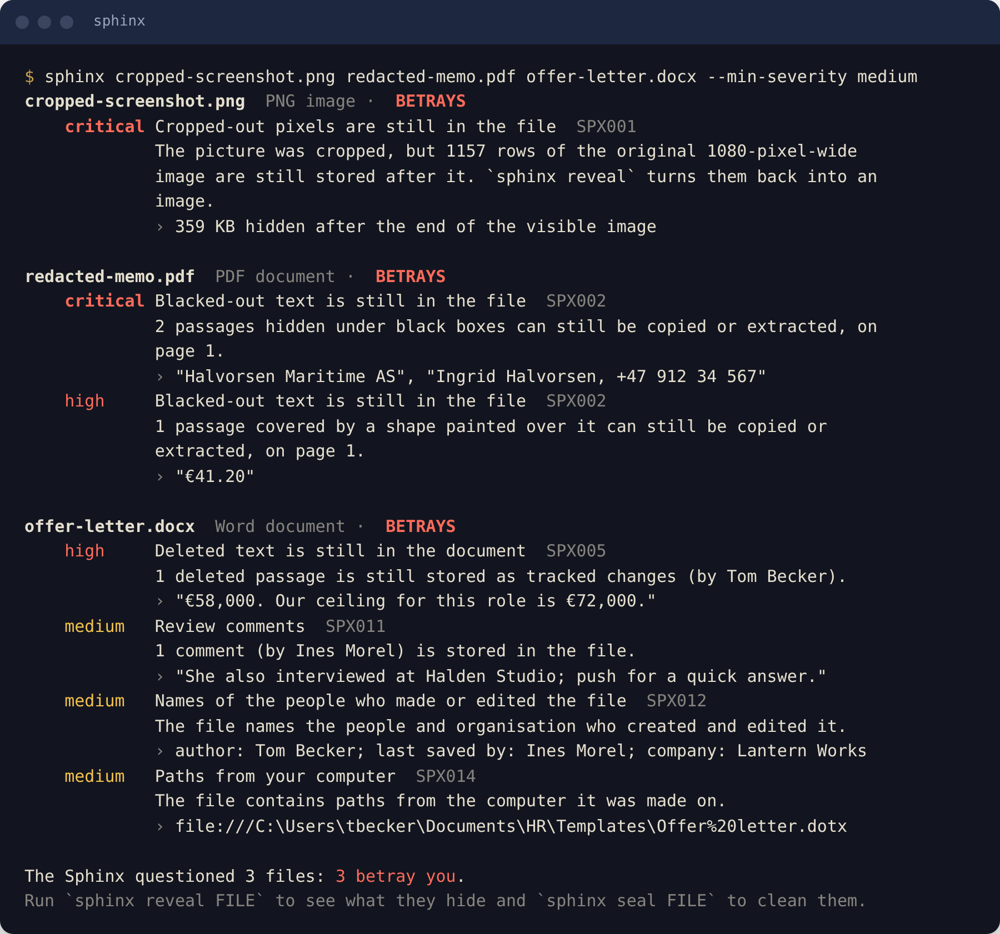
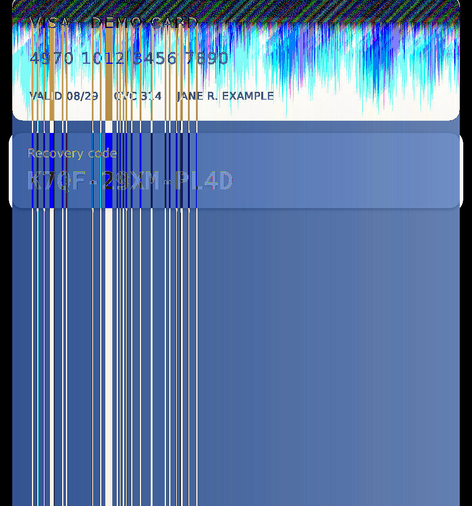

<p align="center">
  
</p>

<h1 align="center">Sphinx</h1>

<p align="center"><strong>Know what your files give away before you share them.</strong></p>

<p align="center">
  <a href="https://github.com/xCeg/Sphinx/actions/workflows/ci.yml"></a>
  <a href="https://github.com/xCeg/Sphinx/releases"></a>
  <a href="https://pkg.go.dev/github.com/xceg/sphinx"></a>
  <a href="LICENSE"></a>
  <a href="https://xceg.github.io/Sphinx/"></a>
</p>

<p align="center">
  <a href="#why">Why</a> ·
  <a href="#quick-start">Quick start</a> ·
  <a href="#what-it-finds">What it finds</a> ·
  <a href="#how-it-works">How it works</a> ·
  <a href="#calibration">Calibration</a> ·
  <a href="#usage">Usage</a> ·
  <a href="#integrations">Integrations</a> ·
  <a href="#limitations">Limitations</a>
</p>

<p align="center"></p>

Sphinx reads a photo, screenshot, PDF or Office file and tells you, in plain words, what it reveals beyond what you see: pixels that survived a crop, text under black boxes, earlier versions, deleted passages, hidden sheets, GPS positions, serial numbers and names. Then it can show you those hidden parts (`sphinx reveal`) and write a cleaned copy (`sphinx seal`).

It is a single binary with no dependencies, and [a web page](https://xceg.github.io/Sphinx/) that runs the same engine inside your browser, so the file never leaves your machine.

## Why

What a viewer shows you is not the file. It is one rendering of it, and files keep a lot that no viewer draws.

- **March 2023.** Simon Aarons and David Buchanan found that the Markup editor on Google Pixel phones saved a cropped screenshot by writing it over the original without shortening the file. The bottom of the original stayed behind and could be decoded again. The Windows Snipping Tool had the same flaw. They are tracked as CVE-2023-21036 and CVE-2023-28303 ([aCropalypse](https://en.wikipedia.org/wiki/ACropalypse)).
- **January 2019.** Paul Manafort's lawyers filed a document whose blacked-out passages could be selected, copied and pasted, revealing what the redactions were meant to hide ([Columbia Journalism Review](https://www.cjr.org/analysis/manafort-mueller-redacted-document-ukraine.php)).
- **December 2012.** A photo of John McAfee, then wanted for questioning in Belize, was published with its EXIF GPS coordinates intact. They placed him in Guatemala ([NPR](https://www.npr.org/sections/thetwo-way/2012/12/04/166487197/betrayed-by-metadata-john-mcafee-admits-hes-really-in-guatemala)).
- **October 2005.** A UN report on the assassination of Rafik Hariri was released as a Word file. Its tracked changes showed names deleted from the final text ([Mehlis report](https://en.wikipedia.org/wiki/Mehlis_report)).

Each of these was a file that looked fine on screen. The tools that exist each cover a slice: `exiftool` lists metadata, `mat2` strips it, a few scripts detect aCropalypse, the Free Law Project's `x-ray` finds bad PDF redactions. None of them answers the question a person actually has before pressing send, *what does this file give away?*, across the formats people actually send, in words a non-specialist understands.

## Quick start

```sh
go install github.com/xceg/sphinx/cmd/sphinx@latest   # or grab a binary from Releases
sphinx ~/Desktop/to-send/
```

Or open <https://xceg.github.io/Sphinx/> and drop a file on the page. The four example files used throughout this README are in [`site/examples`](site/examples); every leak in them is planted and every name invented.

```sh
sphinx reveal cropped-screenshot.png    # writes cropped-screenshot.revealed/…uncropped.png
sphinx seal holiday.jpg                 # writes holiday.sealed.jpg, then checks it again
```

<p align="center"></p>

| What anyone opening `cropped-screenshot.png` sees | What `sphinx reveal` gets back from the same file |
|---|---|
|  |  |

## What it finds

| Rule | What the file gives away | Formats | `reveal` | `seal` |
|---|---|---|:-:|:-:|
| `SPX001` hidden-crop | Cropped-out pixels still stored after the image (aCropalypse) | PNG | yes | yes |
| `SPX002` blacked-out-text | Text under boxes painted over it | PDF | yes | |
| `SPX003` unapplied-redaction | Redaction marks that were never applied | PDF | yes | |
| `SPX004` earlier-revision | Earlier versions kept by incremental saves, with the words they lost | PDF | yes | |
| `SPX005` deleted-text | Passages deleted under Track Changes | DOCX | yes | |
| `SPX006` gps-location | Where the photo was taken | JPEG, PNG | | yes |
| `SPX007` thumbnail-mismatch | A preview that still shows what was cropped or retouched away | JPEG | yes | yes |
| `SPX008` hidden-video | The video and sound of a motion photo | JPEG | yes | yes |
| `SPX009` trailing-data | Data stored after the end of an image | JPEG, PNG | yes | yes |
| `SPX010` hidden-content | Hidden text, hidden and very hidden sheets, hidden rows, pivot caches, hidden slides, speaker notes | DOCX, XLSX, PPTX | yes | |
| `SPX011` comments | Review comments and who wrote them | PDF, Office | yes | |
| `SPX012` personal-names | Authors, last editors, company | all | | images, Office |
| `SPX013` device-serial | Camera and lens serial numbers | JPEG, PNG | | yes |
| `SPX014` local-paths | Paths such as `C:\Users\alice\…` in templates, links and history | PDF, Office | | Office |
| `SPX015` embedded-files | Attachments and embedded objects | PDF, Office | yes | |
| `SPX016` embedded-text | Captions, comments, AI generation prompts | JPEG, PNG | | yes |
| `SPX017` timestamps | Creation, edit and print dates | all | | images, Office |
| `SPX018` software-trail | Device, software, edit count and editing time | all | | images, Office |

The full text of each rule, as shown by `sphinx rules RULE`, is in [docs/rules.md](docs/rules.md). That file is generated from the code, and a test fails when it falls behind.

Each file gets a verdict: **silent** (nothing found), **whispers** (only low-severity details such as timestamps), or **betrays** (anything medium or worse).

## How it works

```
          bytes ──► sniff by content ──► PNG │ JPEG │ PDF │ DOCX/XLSX/PPTX
                                          │
              ┌───────────────────────────┼───────────────────────────────┐
              ▼                           ▼                               ▼
     data after the end            what is painted where            parts no viewer shows
  (IEND/EOI, orphan DEFLATE)   (content streams, paint order)   (tracked changes, notes…)
              │                           │                               │
              └──────────► findings (rule, severity, plain-language message, evidence)
                                          │
                     text · JSON · SARIF · Markdown │ reveal │ seal
```

Everything is written from scratch on Go's standard library. Three parts carry most of the weight.

**Recovering a crop without being told the original size.** After a cropped PNG ends, an aCropalypse file holds the tail of the original's compressed stream, starting mid-way through a DEFLATE block, with the 32 KiB of history it refers to gone. `internal/inflate` is a DEFLATE decoder that tolerates this: references into the missing history produce bytes flagged as unknown instead of an error. To find where a block starts, it tries every bit offset. Only offsets that begin a dynamic-Huffman block whose two prefix codes are complete are fully decoded, and the decode must finish exactly on the byte before the Adler-32 checksum. Most random offsets fail within a few dozen bits. The original width is then inferred, not asked for. PNG rows resemble the row above, so the most frequent back-reference distances in the stream point at the row stride. Candidates are confirmed because counting back from the end lands on filter-type bytes, and then ranked by how smooth the image is once unfiltered. On the 1080×2000 example screenshot, `sphinx reveal` takes about half a second, PNG encoding of the result included.

**Seeing what a PDF paints, in order.** A redaction is a question of order: a box drawn after the text hides it, a box drawn before it is a background. The PDF reader in `internal/pdf` locates objects by scanning rather than trusting the cross-reference table, which is often stale in exactly the files worth checking. It unpacks object streams, decodes the usual filters and interprets content streams far enough to place every glyph, with fonts, ToUnicode maps, widths and text matrices, and every filled rectangle, with colour, opacity, blend mode, clipping and form bounding boxes. A glyph counts as hidden when an opaque rectangle painted later covers its centre and most of its area. Annotation appearances are rendered too, because their declared interior colour is often not what a viewer draws. Every incremental update is replayed as its own document, and the words present in an older revision but missing from the final one are reported.

**Comparing a photo with its own preview.** Both images are reduced to a 32×32 luminance grid after trimming letterbox bars and normalising brightness and contrast. Previews that show *less* than the photo, a centre crop as some cameras make, are accepted. Previews that show more, or something else, are reported.

## Calibration

Sphinx was run on 1,869 public test files: the [pdf.js](https://github.com/mozilla/pdf.js/tree/master/test/pdfs) and [py-pdf](https://github.com/py-pdf/sample-files) PDF suites, the [exif-samples](https://github.com/ianare/exif-samples) camera collection and [Apache POI](https://github.com/apache/poi/tree/trunk/test-data)'s Office test data. Many of them are deliberately malformed: fuzzer crash cases, truncated and encrypted files. `scripts/fetch-corpus.sh` pins all four to the exact commits used, and `go run ./scripts/calibrate DIR` prints these tables.

| Format | Files | Size | Unreadable | Medium or worse | Time |
|---|---:|---:|---:|---:|---:|
| DOCX | 136 | 8 MB | 13 | 102 | 0.68 s |
| JPEG | 104 | 46 MB | 1 | 25 | 2.36 s |
| PDF | 1,140 | 163 MB | 27 | 205 | 7.36 s |
| PNG | 15 | 2 MB | 0 | 0 | 0.00 s |
| PPTX | 93 | 22 MB | 11 | 79 | 1.00 s |
| XLSX | 381 | 22 MB | 13 | 305 | 3.71 s |

The run took 15.1 s on one core of an Intel Xeon at 2.10 GHz, with no crash and no hang. The unreadable files are 27 encrypted PDFs, 37 Office files that are not valid zip archives (mostly minimised fuzzer cases) and one truncated JPEG.

"Medium or worse" is dominated by author names (`SPX012`), which Office and PDF producers write by default. The serious findings were each checked by hand:

| Finding | Files | Checked how | Result |
|---|---:|---|---|
| `SPX004` earlier revision with removed words (high) | 12 PDFs, 17 findings | each revision extracted with `sphinx reveal`, then text extracted from it and from the final file with poppler's `pdftotext` | 16 findings confirmed word for word. In the 17th, the final file has no extractable text at all, so the old words are indeed gone. |
| `SPX002` text under a box | 7 PDFs | pages rendered with poppler's `pdftoppm` and inspected | In all 7 the reported text is genuinely painted over and invisible. All are test fixtures about overlapping graphics or web pages printed under a sticky header; none hides personal data. |
| `SPX007` stale preview | 1 JPEG | preview extracted and compared by eye | The photo was cropped to the car; the preview still shows the whole car park. |

Calibration also changed the code. The first run reported text in charts and diagrams as hidden. Four causes were found and fixed, each with a regression test (`TestCalibrationNearMisses`): fills clipped away by a form's bounding box, text used as a clipping path, an annotation whose appearance differs from its declared colour, and an edited line boxed over with its new version printed on top. Thumbnail thresholds come from the same corpus. The 32 unedited camera previews stay within 0.18 standard deviations of their photo, the cropped photo's stale preview scores 0.83, and the threshold is 0.45.

## Usage

```
sphinx [gaze] [flags] FILE|DIR...   inspect files and report what they leak
sphinx reveal [-o DIR] FILE...      extract what the files hide
sphinx seal [-o DIR | --in-place] FILE...
                                    write copies with the leaks removed, then re-inspect them
sphinx rules [RULE]                 explain each kind of leak
sphinx version
```

Directories are walked recursively. Only files whose *content* is a supported format are inspected, whatever their extension, and `.git`, `node_modules` and hidden directories are skipped. `-` reads standard input.

| Flag (`gaze`) | Default | |
|---|---|---|
| `--format` | `text` | `text`, `json`, `sarif` or `markdown` |
| `--fail-on` | `medium` | exit 1 when a finding reaches this severity (`low`, `medium`, `high`, `critical`, `never`) |
| `--min-severity` | `low` | hide findings below this severity |
| `--exclude` | | skip paths matching a glob or directory name while walking; repeatable |
| `--quiet` | | list only files that leak or could not be read |
| `--no-color` | | colours are also off when `NO_COLOR` is set or output is not a terminal; `FORCE_COLOR` turns them on |

| Exit code | Meaning |
|---|---|
| 0 | nothing at or above `--fail-on` |
| 1 | at least one finding at or above `--fail-on` (for `seal`: one survived sealing) |
| 2 | usage error |
| 3 | a file could not be read or parsed, and nothing reached `--fail-on` |

**What `seal` does and does not do.** For images, it keeps only what decoding needs: pixels, colour profile and orientation. Orientation is kept in a minimal EXIF block so portraits do not turn sideways. Everything else goes: metadata, previews, trailing data, motion-photo video. For Office files, it rewrites the document properties, strips local paths from external links and seals the pictures inside. It deliberately leaves tracked changes, comments and hidden content alone, because deciding what a document says is the author's job. Those stay in the report printed after sealing. PDFs cannot be sealed: removing text under a box properly means rewriting content streams, and a tool that gets that subtly wrong is worse than none. Use a real redaction feature, then check the result with Sphinx.

## Integrations

**GitHub Action.** Fail a pull request that adds a leaking document, and send findings to code scanning:

```yaml
- uses: xCeg/Sphinx@v0.1.0
  with:
    paths: docs/ press/
    fail-on: medium
    sarif: sphinx.sarif
- uses: github/codeql-action/upload-sarif@51f77329afa6477de8c49fc9c7046c15b9a4e79d # v3.29.5
  if: always()
  with:
    sarif_file: sphinx.sarif
```

**pre-commit.**

```yaml
- repo: https://github.com/xCeg/Sphinx
  rev: v0.1.0
  hooks:
    - id: sphinx
```

**Docker.** No image is published yet; build one from the repository:

```sh
docker build -t sphinx .
docker run --rm -v "$PWD:/work" sphinx .
```

**Go library.**

```go
import "github.com/xceg/sphinx"

findings, err := sphinx.Inspect(data)   // most severe first
hidden, err := sphinx.Reveal(data)      // []Artifact{Name, Note, Data}
clean, err := sphinx.Seal(data)
```

**In the browser.** [`cmd/sphinx-wasm`](cmd/sphinx-wasm) compiles the library to WebAssembly for the [website](https://xceg.github.io/Sphinx/). `make serve` runs it locally. The page has a strict Content Security Policy, no analytics and no server-side code.

## Limitations

- **Formats.** HEIC/HEIF photos (the iPhone default), WebP, TIFF, ODF, legacy `.doc`/`.xls`/`.ppt`, email and video are not read yet. Encrypted PDFs and Office files are reported as unreadable, even when they open without a password.
- **Recovered crops are imperfect.** Bytes that referred to the lost part of the stream are decoded as zero, and the error propagates down through PNG's Up and Paeth filters as colour drift. Text usually stays legible, as in the example, but not always. Only crops written over the original are recoverable; a crop saved as a new file leaves nothing behind.
- **PDF geometry is approximate.** Glyph boxes come from font metrics, not glyph outlines. Non-rectangular shapes are not treated as covers. Text hidden by images, by white text on white, by being clipped out of view or by sitting outside the page is not detected. Scanned documents whose redactions are burned into the image are, correctly, not reported, but neither is an invisible OCR layer under such a box.
- **Revision diffs compare words, not meaning.** A word removed in one place but present elsewhere in the final version is not reported, and form-field values are compared only through what the page content draws.
- **Absence of findings is not proof of safety.** Sphinx answers eighteen specific questions, and a file can leak in ways none of them covers, starting with what is plainly visible in it.

## Roadmap

- HEIC and WebP photos, ODF documents, legacy Office binaries.
- Opening PDFs and Office files encrypted with an empty password.
- `seal` for PDF metadata and earlier revisions, which can be dropped without touching page content.
- Detecting text hidden by images and by white-on-white in PDFs.
- A share-sheet extension for phones, built on the WebAssembly engine.

## Contributing

Bug reports with a reproducible file are the most valuable contribution. Please make the file with invented content, never real personal data. See [CONTRIBUTING.md](CONTRIBUTING.md) for the layout of the code and the rule that every new check comes with a test for the closest legitimate case. Security issues go through [SECURITY.md](SECURITY.md).

## License

[MIT](LICENSE).
